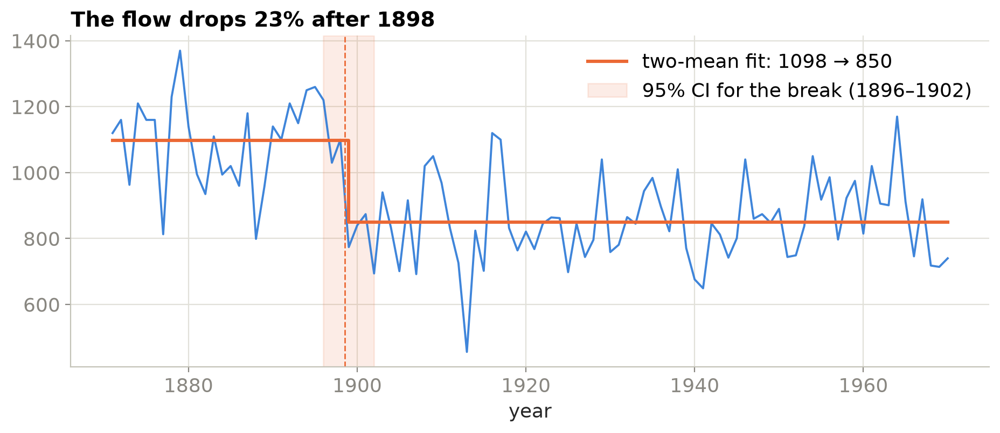

# The Nile at Aswan, 1871–1970: finding the year the river changed

A change-point study of a classic series: one hundred years of the Nile's annual flow at Aswan. Three detection methods find the same break within two years of each other (1898–1900), a bootstrap puts it inside 1896–1902, and the mean flow falls by a little over a fifth and never recovers in the record. The notebook then asks what caused it and tests, honestly, how much a forecaster gains from knowing about it (a bias fix, not a noise fix).

| | |
|---|---|
| Notebook | [`nile_river_flow.ipynb`](nile_river_flow.ipynb) (executed, outputs included) |
| Data | `data/Nile.csv`: Durbin & Koopman (2001) via R's `datasets::Nile`, 100 annual values in 10⁸ m³ |
| Outputs | `figures/` (3 charts), `results/` (change points, stationarity tests, forecast scores) |



## Results

| Method | Break after | Mean before → after |
|---|---|---|
| Binary segmentation, one break (`ruptures`) | 1900 | 1,078 → 851 |
| PELT, penalty chooses the number of breaks (found 1) | 1900 | 1,078 → 851 |
| Two-mean scan with a 2,000-draw bootstrap | 1898 (95% CI 1896–1902) | 1,098 → 850 |

Once the step is removed the residuals pass a Ljung–Box test (p = 0.23): there is no year-to-year memory left, so a forecast is a level plus noise and the only decision that matters is which level.

| Forecast of 1951–1970 | RMSE | Mean forecast | Actual mean |
|---|---|---|---|
| AR(1) on the whole history (ignores the break) | 131 | 928 | 877 |
| AR(1) on the post-break years only | 128 | 840 | 877 |
| Post-break mean | 128 | 840 | 877 |

The whole-history model aims high, the post-break model aims low, and the gain is three RMSE points against a year-to-year standard deviation of about 120. Knowing the break removes a bias; it cannot remove the noise, and the notebook says so rather than claiming a win.

## Why 1898?

A run of weak monsoons over the Ethiopian highlands, where most of the flood water originates, began in 1898 and the drier regime persisted; the first Aswan Low Dam was built in 1899–1902 and the gauging changed in the same years. The gauge saw a climate shift with the dam as a coincident marker, which is the reason a statistical change point needs a cause outside the data before it becomes a story.

## Reproduce

```bash
pip install -r requirements.txt
python make_notebook.py                     # writes the notebook from source
jupyter nbconvert --to notebook --execute --inplace nile_river_flow.ipynb
```

## Author

Omar Essam El Sherbiny: [website](https://omaressam.web.app) · [LinkedIn](https://www.linkedin.com/in/omar-essam-el-sherbiny-b602279b/)
